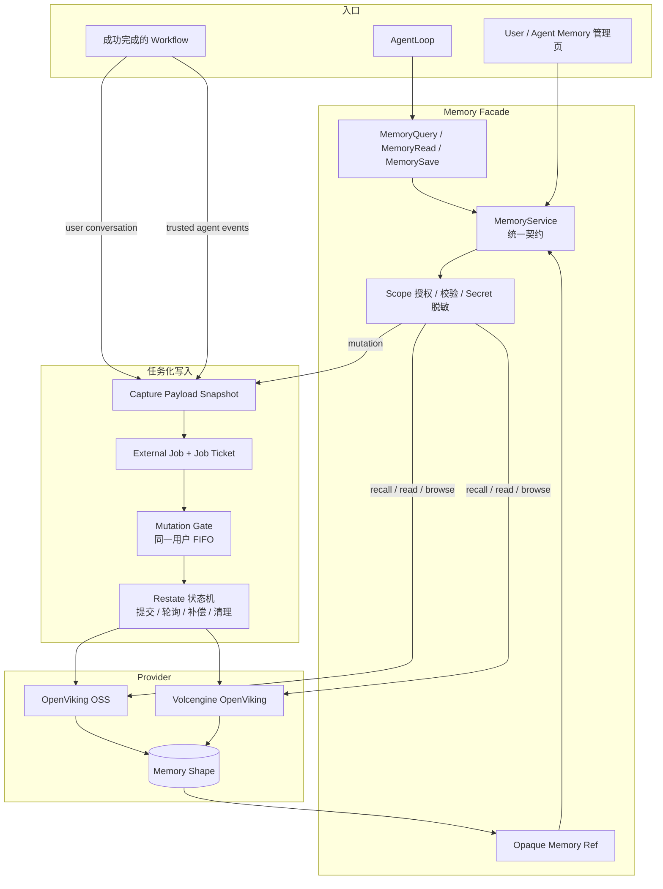
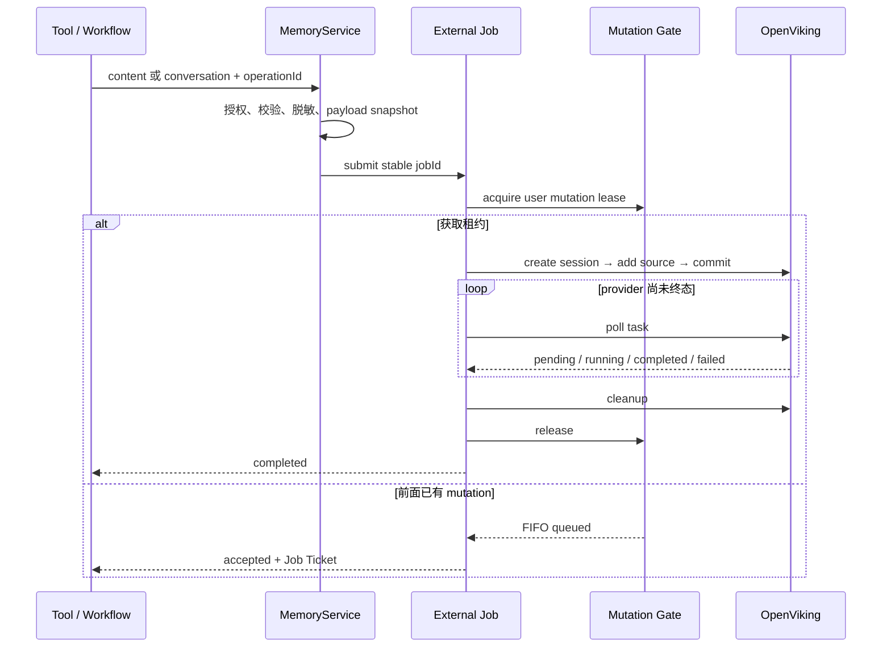
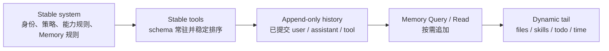

# Shrimp Agent 记忆模块：异步形成、按需召回与稳定 Prompt 前缀

## 结论先行

Shrimp 没有把长期记忆全文自动拼进 system prompt，而是把它做成独立能力：

- 写入时只提交内容或已完成的对话，由 Memory backend 负责提取、总结、去重和组织；
- 读取时由模型按需执行 `MemoryQuery → MemoryRead`，先选候选，再读全文；
- stable prompt 只放 Memory 使用规则与固定工具 schema，真正的记忆正文作为工具结果追加在消息尾部；
- remember、capture、update、delete、clear 都进入带幂等键的异步任务，不能把 `accepted` 误报成“已保存”；
- User Memory 与 Agent Memory 分开授权，跨用户 Agent Experience 只记录隐私最小化的结构事件。

提高 prompt cache 命中的关键不是让记忆不变化，而是：**稳定规则留在前缀，动态记忆只追加到后缀，不回写已经发给模型的内容。**

## 一、两种 Memory Scope

### User Memory

属于当前用户，保存跨会话有价值的偏好、项目背景、长期约定和已确认事实。Agent 可以搜索、读取和保存当前用户的记忆；成功完成的 Chat workflow 也可以异步提交本轮对话，让 backend 判断是否形成长期记忆。

### Agent Memory

绑定某个 Agent。owner 或管理员可以管理内容；被信任的系统 Agent 还可以在 workflow 结束后写入 Agent Experience。

Agent Experience 不保存用户原文、Agent 回复、工具名称、参数或输出，只投影成：

```text
request-received / delegation-received / response-produced
tool-invoked / tool-completed / tool-failed
```

因此它是一条跨用户的结构经验通道，不是共享聊天记录。

## 二、端到端架构



`MemoryService` 屏蔽 provider 差异，并统一处理 scope、错误码和不透明引用。`memory:v1:...` ref 内封装 backend、scope 与 provider locator，但 ref 不是权限凭证：每次 read/update/delete 都会重新校验 backend、scope、节点类型和 locator 边界。

权限规则是：

| 操作 | User Memory | Agent Memory |
| --- | --- | --- |
| browse / recall / read | 仅 actor 自己 | 需要该 Agent 的使用权限 |
| remember / update / delete / clear | 仅 actor 自己 | 仅 owner 或管理员 |
| conversation capture | 仅当前用户 | 不走普通 capture |
| Agent Experience | 不适用 | 需要可信采集权限 |

## 三、记忆如何写入和更新

### 主动保存

`MemorySave` 只收 `content`，不让模型决定存储路径。调用使用 `workflowId + toolCallId` 组成稳定 `operationId`，等待最多 15 秒：

- `completed` 且确实产生记录，才能告诉用户“已记住”；
- `accepted` 表示仍在处理，只能返回 pending 和 Job Ticket；
- completed 但影响条数为 0，也不能声称保存成功。

Shrimp 会把模型同一步中过早输出的“已保存”纠正为真实工具结果，避免未经证实的成功声明进入下一步历史。

### 自动形成

Chat 只有在 workflow 成功完成且 Memory 已启用时才 dispatch capture：User lane 总是提交；Agent lane 只对可信 Agent 开启。Member workflow 还要求执行策略没有禁用 `memoryWrite`。

自动 capture 发生在回答完成之后，所以不会影响当前回答，只服务未来召回。对话先脱敏，再保存为带 digest 和字节数的 payload snapshot；Restate journal 只携带 payload ref，避免复制大段私有正文。

### 任务状态机



同一用户的写操作通过 FIFO mutation gate 串行化。任务具备租约、重试、超时、恢复与清理；update 还经过 plan、prepare、verify、activate、retire，失败时 rollback 或 compensation，并返回最终 `effectiveRefs`，所以更新后不能假定 ref 永远不变。

手工内容上限为 64 KiB UTF-8，conversation capture 上限为 128 KiB；Secret 在跨越 Memory provider 边界前会被脱敏。

## 四、先 Query，再 Read

```text
MemoryQuery(query, limit ≤ 20)
  → title + preview + scope + opaque ref

MemoryRead(ref)
  → 被选中记忆的完整正文
```

Query 默认搜索当前用户；如果 AgentLoop 绑定了 Agent，还会搜索该 Agent 的 Memory。各 scope 独立执行，因此一个 scope 失败时，另一个仍可返回结果和 partial-failure 警告。

两阶段读取避免一次召回就把多个长文档全部塞入上下文。模型必须先选候选，再读取真正要依赖的全文。

## 五、记忆如何进入模型输入

当前 Chat 不做 eager recall。模型初始只看到：

- stable system 中简短的 Memory 规则；
- 常驻、稳定的三个 Memory 工具 schema；
- dynamic tail 中的按需召回提醒。

遇到“上次”“之前”“那个项目”、历史偏好或长期决策时，模型才调用 Query/Read。其结果成为正常工具历史：

```text
[stable system + stable tools]
[既有历史]
[MemoryQuery call/result]
[MemoryRead call/full result]
[当前 dynamic tail]
```

因此 backend 中的记忆发生变化，不会自动改写本轮 prompt；只有重新查询后，新结果才追加到尾部。召回内容始终是 context，不是 instruction，当前请求和平台规则优先。

Prompt builder 虽然保留显式 `memoryContext` 注入口，但普通 Chat 默认不传；即使传入，它也属于 dynamic state，而不是 stable system。

## 六、怎样保持稳定前缀



### 1. Stable 与 Dynamic 分离

Agent identity、平台规则、capability 说明和固定协议放在 stable system。Todo、文件、已加载 Skill、召回提示和时间放在 dynamic tail。

dynamic state 被编码成尾部 user message，并用 system-reminder 框架声明它是运行态，而不是每一步都变化的 system message。时间还会对齐到 30 分钟边界，减少无意义变化。

### 2. 工具 schema 从第一步常驻

如果 `SkillLoad` 后才把工具插入 tools 数组，整个前缀会从 schema 位置变化。Shrimp 当前让 capability domain 的工具 schema 常驻，并在每步稳定排序；SkillLoad 主要加载详细说明，不再改变 schema 集合。

Memory backend 或 `long-term-memory` grant 被关闭时，Memory 规则与工具会一起消失；开启和关闭状态本来就是两份不同前缀。

### 3. 投影契约在 admission 时冻结

普通单 Agent Chat 在接纳 invocation 时冻结 prefix-stability contract。Workflow replay 沿用当时的投影规则，不会因部署新代码而改写已发送历史。

当前投影还会固定首次发送的 Skill 内容、折叠重复 runtime injection、保持已发送 ToolResult 的物化形态，并把新状态追加到 step boundary。目标都是让早期字节保持不变。

## 七、Provider 的缓存断点

| Provider | 显式策略 |
| --- | --- |
| DashScope OpenAI-compatible | 最多四个 `cache_control`：system、第一条 user、倒数第三和倒数第二条已提交消息；最后的 dynamic tail 不标记 |
| Anthropic | system 末尾使用稳定头部断点，另标第一条 message、倒数第二条 message、最后一条中的最新 `tool_result`；动态文本留在断点后 |
| OpenAI/Azure Responses | 仅已知支持的模型使用稳定 `promptCacheKey`，并标记 developer prefix、最近两条已完成 user、可选当前轮最新 tool result |
| DashScope DeepSeek V4 | 使用 provider 隐式 prefix cache，不发送显式 marker |

Anthropic 稳定头部默认使用 1 小时 TTL，以覆盖长工具调用；滚动历史使用短期 ephemeral 缓存。OpenAI Responses 还可以在严格验证 system、模型、参与者和消息摘要一致时使用 `previousResponseId`，只发送新增消息；验证失败就回退到完整输入。

`promptCacheKey`、`cache_control` 和 `previousResponseId` 都只是 provider 优化接口。是否真正命中，要看 provider 返回的 cache-read/cache-write token 和 prefix 诊断，不能只看请求里是否存在标记。

## 八、哪些变化会破坏缓存

会破坏已有前缀：

- 修改 identity、thinking strategy、runtime instructions 或 capability grant；
- 改工具名称、描述、schema、集合或顺序；
- 把 recalled memory、Todo、时间或文件列表插入 system；
- 回写已经发送的 ToolResult、SkillLoad 结果或早期历史；
- 历史压缩改写早期消息；
- 切换 model、provider、protocol 或 fallback；
- TTL 到期或 provider 淘汰缓存。

通常只增加尾部、不破坏更早断点：

- 新增用户消息；
- 追加 MemoryQuery/MemoryRead 的 call 与 result；
- 尾部 Todo、时间、文件状态变化；
- backend 记忆更新，但当前请求没有重新查询。

Prompt cache 匹配的是最长公共前缀，不要求整个请求完全相同。

## 九、准确性边界

1. Memory backend 决定提取质量；completed 但形成 0 条是合法结果。
2. Query 命中不代表事实仍然正确，模型必须读取全文并结合当前请求判断。
3. 按需召回依赖模型决策，规则和 hint 只能提高调用概率。
4. 自动 capture 在 workflow 成功后执行，不参与当前回答。
5. Prompt cache 不是强一致缓存；TTL、容量、路由和模型切换都可能造成 miss。
6. 真正可验证的目标是：stable system 与 tools 字节稳定、历史只追加，以及 provider usage 中出现预期的 cache read。
