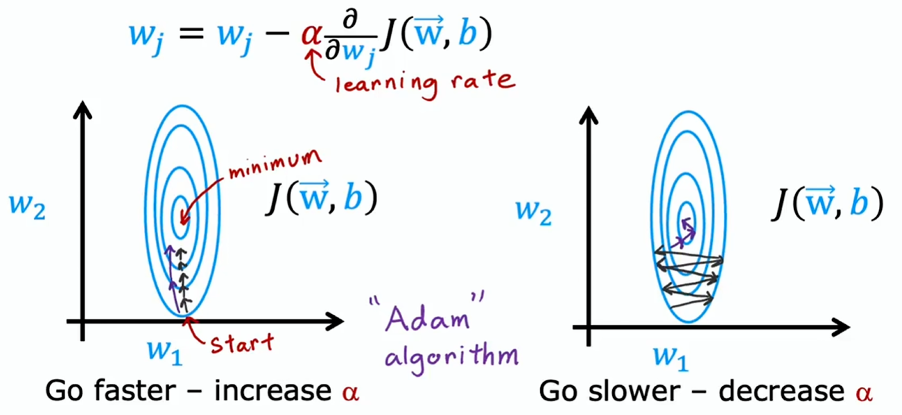
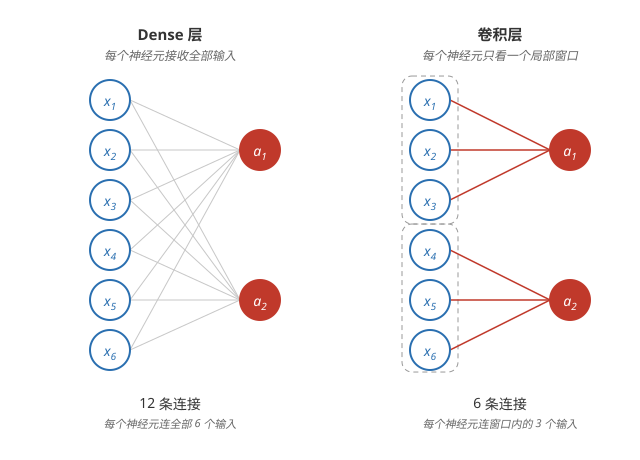

# 进阶网络概念（Additional Neural Network Concepts）

## Adam 算法

**与普通梯度下降的区别** —— 普通梯度下降所有参数共用一个学习率 α：设小了收敛慢，设大了来回震荡，很难找到一个对每个参数都合适的值。普通梯度下降见[梯度下降](../ml/gradient-descent.md)。

**Adam 的想法** —— 让每个参数有自己的学习率，训练中自动调整：某个参数每次更新方向都一致（梯度一直朝同一个方向走），就调大它的学习率、迈大步；来回震荡（梯度方向反复翻转），就调小它的学习率、迈小步。Adam 全称 Adaptive Moment estimation（自适应矩估计）。



**算法** —— 维护梯度的指数加权平均 m（一阶矩，衡量方向）和梯度平方的指数加权平均 v（二阶矩，衡量幅度），用它们缩放每一步：

```math
w_j := w_j - \alpha \frac{m_j}{\sqrt{v_j} + \varepsilon}
```

梯度方向一致时 $m_j$ 累积变大、步长加大；震荡时 $m_j$ 抵消变小、步长收缩；$v_j$ 大（梯度陡）时步长自动调小。

**超参数** —— α（基础学习率）唯一通常要调的，常用 0.001；β₁ = 0.9、β₂ = 0.999 是求 m、v 的指数加权平均衰减率，ε = $10^{-8}$ 防止除以 0，默认值基本不用动。

**用 TensorFlow 实现** —— [训练模型](./model-training.md)里 fit 的代码不用改，TensorFlow 默认就用 Adam；要显式指定学习率：

```python
model.compile(
    optimizer=Adam(learning_rate=1e-3),
    loss=SparseCategoricalCrossentropy()
)
```

## 卷积层

**Dense 层的局限** —— Dense 层每个神经元接收上一层的全部输入。输入很大时（如整张图片），每个神经元的参数非常多，训练慢、费数据、容易过拟合。

**卷积层（convolutional layer）** —— 每个神经元只看输入的一个局部窗口，不同位置的窗口各由一个神经元负责，窗口之间共享同一组参数。参数大幅减少，因此计算更快、需要的数据更少、更不易过拟合。



**一维卷积：EKG 信号** —— 心电图是一串随时间变化的电信号，异常往往看局部波形就能判断：每个隐藏单元只看信号里的一小段窗口，扫过整条信号。

**二维卷积：图像** —— 图像里相邻像素关系紧密：每个神经元只看图片的一小块区域，不同神经元负责不同位置。

**CNN** —— 用卷积层搭的网络叫卷积神经网络（Convolutional Neural Network），广泛用于图像识别等任务。

以上是 Adam 优化器与卷积层；怎么评估模型、诊断偏差与方差见[诊断偏差与方差](./diagnosing-bias-variance.md)。
