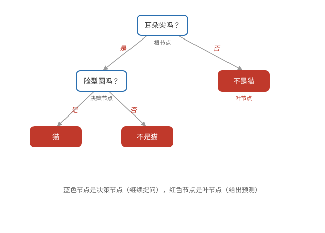
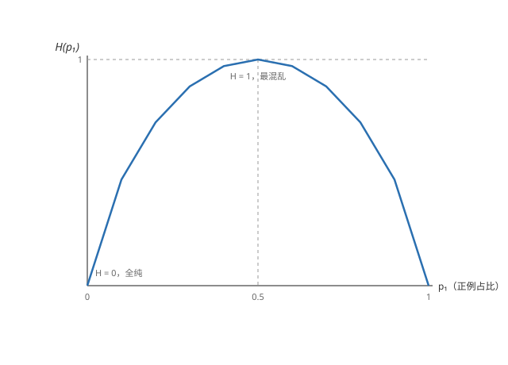
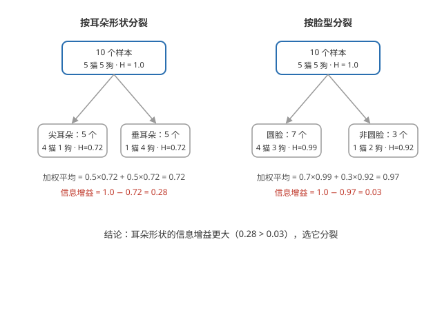
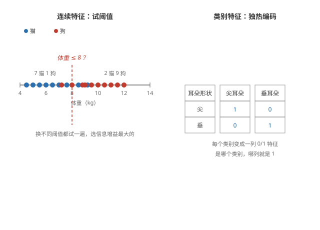

# 决策树（Decision Trees）

## 决策树模型

**结构** —— 决策树用一连串「是/否」问题做预测：从根节点开始提问，每个决策节点按答案分支，走到叶节点得到预测结果。

**一个例子** —— 判断是不是猫：耳朵尖吗？→ 是 → 脸型圆吗？→ 是 → 有胡须吗？一路问下来，叶节点给出「猫」或「不是猫」。



**分类与回归都行** —— 叶节点放类别（猫/不是猫）就是分类树；放数值（如房价）就是回归树。

## 学习过程

**决策树是逐层挑出来的** —— 学习过程就是在每个节点选一个特征来分裂：先看全部候选特征，哪个分得最「纯」用哪个；分出来的左右子集再重复同样的操作，直到叶节点。

## 纯度

**纯度（purity）** —— 分裂的目标就是让左右两组数据更「纯」：同一类的样本尽量扎堆，而不是混杂。一组数据有多纯，用熵（entropy）来度量：

```math
H(p_1) = -p_1 \log_2(p_1) - p_0 \log_2(p_0)
```

p₁ 是正例占比（如猫的比例），p₀ = 1 − p₁ 是负例占比（如狗的比例），两者加起来等于 1。例如 5 猫 5 狗：p₁ = p₀ = 0.5，H = 1 最混乱；全是猫：p₁ = 1、p₀ = 0，H = 0 全纯。



## 信息增益

**信息增益（information gain）** —— 分裂前后熵减少多少，衡量这次分裂把数据理顺了多少：

```math
\text{Information Gain} = H(p_1^{\text{root}}) - \left( \frac{n^{\text{left}}}{n} H(p_1^{\text{left}}) + \frac{n^{\text{right}}}{n} H(p_1^{\text{right}}) \right)
```

左右子集的熵按各自的样本数加权平均。信息增益越大，说明这次分裂越能把数据理顺。



**选增益最大的特征** —— 每个候选特征算一次信息增益，选最大的那个来分裂；分裂出的子集再重复同样的选择。

## 训练过程

**递归分裂** —— 从根节点开始：选信息增益最大的特征分裂 → 对左右子集继续同样操作 → 直到满足停止条件，把节点变成叶节点。

**停止条件** —— 常见的几种：节点纯度已经 100%；达到最大深度；继续分裂的信息增益低于阈值；节点里的样本数太少。

**叶节点的预测** —— 取该叶节点里样本的多数类（分类树）或平均值（回归树）。

## 连续特征与类别特征

**连续特征怎么分** —— 如体重，尝试各个阈值（体重 ≤ 8kg？），选信息增益最大的那个阈值。

**类别特征怎么处理** —— 用独热编码（one-hot encoding）把每个类别变成 0/1 特征，与前面的特征处理一致。



以上是决策树；输出连续数值的回归树，以及随机森林、XGBoost 等多棵树的集成方法，都在下一篇[回归树](./regression-tree.md)里。
