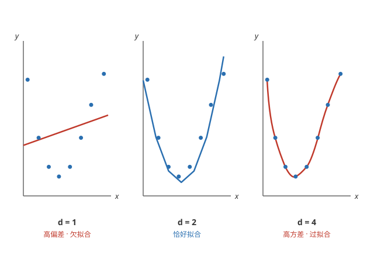
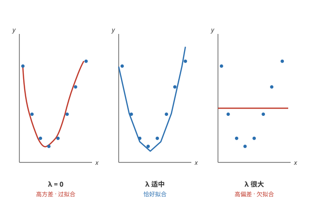
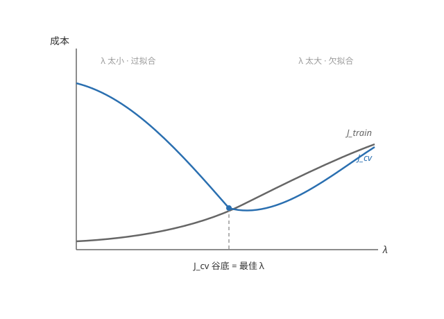
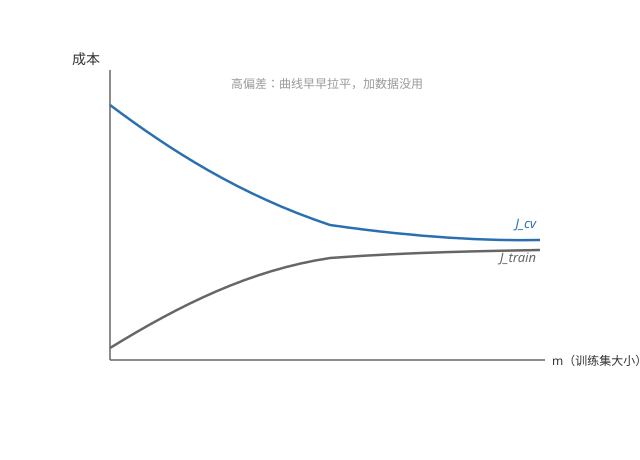
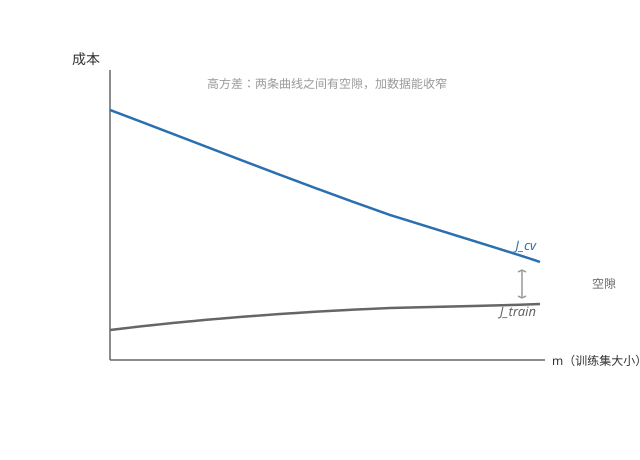

# 诊断偏差与方差（Diagnosing Bias and Variance）

## 模型评估

**训练好不等于好用** —— 模型在训练集上误差小，不代表对新数据预测就好：误差小可能只是把训练数据背了下来。评估泛化能力，要在模型没见过的数据上测误差。

**数据集划分** —— 把数据分成互不重叠的三份：

**训练集（training set）** —— 用来拟合模型参数。

**交叉验证集（cross-validation / dev set）** —— 用来比较候选模型、调超参数，不参与参数拟合。

**测试集（test set）** —— 最后只测一次，报告模型的泛化成绩。

课程给的常用比例是 60/20/20；只做简单评估、不需要选模型时，也可以只分训练/测试 70/30。

**三个成本指标** —— J_train、J_cv、J_test 分别是模型在三份数据上的平均损失：选模型看 J_cv，最终成绩看 J_test。

## 诊断偏差与方差

**回顾概念** —— 高偏差即欠拟合，高方差即过拟合，见[过拟合与欠拟合](../ml/overfitting.md)。

**用成本诊断** —— 比较 J_train 和 J_cv，就能判断模型是高偏差还是高方差：

**高偏差（欠拟合）** —— J_train 很高，J_cv 和它差不多高：模型连训练数据都拟合不好，对新数据也不会好。

**高方差（过拟合）** —— J_train 很低，但 J_cv 远高于它：训练数据被背了下来，换个数据立刻露馅。

**两者都低** —— 拟合得好、泛化也好，理想状态。

**多项式次数的例子** —— 多项式回归次数 d = 1 时是直线，欠拟合；d = 4 时曲线过于灵活、穿过每个点，过拟合；d = 2 恰好：

## λ 如何影响偏差与方差

**回顾** —— 正则化在成本函数后加惩罚项 $\frac{\lambda}{2m} \sum_{j=1}^{n} w_j^2$，λ 控制惩罚力度，基础见[过拟合与欠拟合](../ml/overfitting.md)。

**λ 太小 → 高方差** —— λ = 0 相当于没有正则化：曲线弯弯绕绕穿过每个训练点，J_train 很低、J_cv 很高，过拟合。

**λ 太大 → 高偏差** —— λ 极大时所有参数被压到接近 0，模型退化成常数，几乎是一条水平线：连训练数据都拟合不好，J_train、J_cv 都很高，欠拟合。

**λ 适中 → 恰好** —— 参数被适当缩小，曲线平滑又能跟上数据的规律。

## 用交叉验证选 λ

**试错的流程** —— 拿不准 λ 取多少时，依次尝试一系列候选值，用 J_cv 挑出最好的：

**候选列表** —— 从很小开始逐次翻倍，如 0, 0.01, 0.02, 0.04, ..., 10.24。

**每个 λ 各训练一个模型** —— 在交叉验证集上算出各自的 J_cv。

**选 J_cv 最小的 λ** —— 最后用它训练最终模型，在测试集上算 J_test 报告成绩。

**λ 与两个成本的关系** —— 随着 λ 增大：J_train 单调上升（正则化越强，模型越不迁就训练数据）；J_cv 先降后升，呈 U 形——左侧 λ 太小、过拟合，右侧 λ 太大、欠拟合，谷底就是最合适的 λ。

## 学习曲线

**学习曲线（learning curve）** —— 横轴是训练集大小 m，纵轴是成本：画出 J_train 和 J_cv 随 m 的变化，就能看出加数据到底有没有用。

**高偏差模型的学习曲线** —— J_train 随 m 增大而上升（样本少时容易拟合，越多越难）；J_cv 随 m 增大而下降。但两条曲线很快就趋于平坦、贴到一起：模型能力有限，再多数据也学不到新规律。

**结论** —— 高偏差时加数据没用，应该换更复杂的模型或加特征。

**高方差模型的学习曲线** —— J_train 一直很低（模型够复杂，训练集再大也拟合得好）；J_cv 一直较高，但随 m 增大持续下降。两条曲线之间有明显空隙，且随数据增多逐渐收窄。

**结论** —— 高方差时加数据有用：空隙随数据增多收窄。这正是「增加训练数据」能解决过拟合的直观依据。

以上是模型评估、偏差方差的诊断、正则化与学习曲线；下一步怎么用这些工具迭代改进模型，在后面的内容里再展开。
