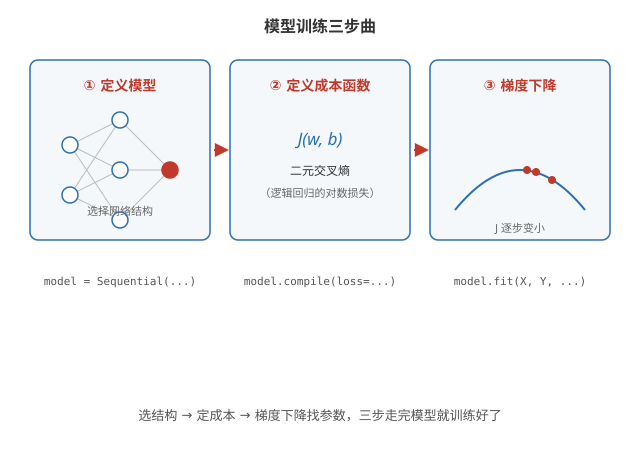
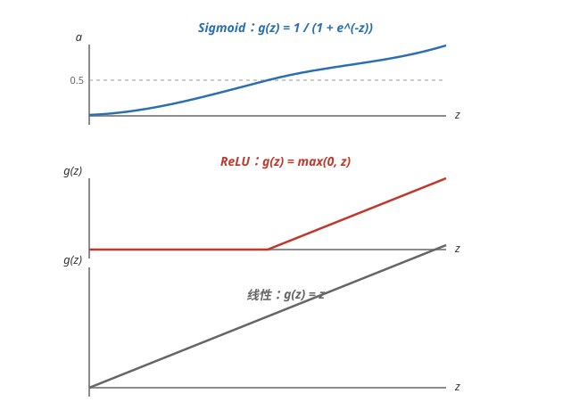

# 训练模型（Training a Model）

## 模型训练步骤

训练任何模型——线性回归、逻辑回归、神经网络——都是同样的三步：

**第一步：定义模型** —— 指定如何根据输入 x 和参数 w、b 算出输出 f(x)。对神经网络来说，就是选择网络结构：几层、每层几个神经元、用什么激活函数。

**第二步：定义损失与成本函数** —— 衡量当前参数下模型预测得有多差。二分类神经网络用二元交叉熵（Binary Cross Entropy），也就是逻辑回归的对数损失，见[逻辑回归](../ml/logistic-regression.md)。

**第三步：用梯度下降最小化成本** —— 反复调整参数让成本 J 下降，直到收敛。训练模型做的就是这件事。

三步走完，得到一组参数 w、b；拿到新样本，用前向传播即可算出预测。



## 用 TensorFlow 训练模型

TensorFlow 把三步各对应一段代码。以咖啡烘焙的二分类网络为例（2 个特征 → 3 个隐藏神经元 → 1 个输出）：

**第一步：Sequential 定义网络结构** —— Sequential 把各层依次串起来，Dense 就是前面手写的 dense 函数：

```python
model = Sequential([
    Dense(units=3, activation='sigmoid'),
    Dense(units=1, activation='sigmoid')
])
```

**第二步：compile 指定成本函数** —— 二分类用 BinaryCrossentropy：

```python
model.compile(loss=BinaryCrossentropy())
```

**第三步：fit 开始梯度下降** —— 用数据 X 和标签 Y 训练，epochs 指定梯度下降的迭代轮数（每轮扫过全部训练数据，更新一次参数）：

```python
model.fit(X, Y, epochs=100)
```

**训练好的模型怎么用** —— predict 传入新样本，输出预测值：

```python
predictions = model.predict(X_new)
```

**底层仍是梯度下降** —— TensorFlow 没有魔法：fit 内部就是在做前几篇学的梯度下降（用更高效的变体），每一步更新参数、降低成本，只是不用手写更新公式了。

激活函数怎么选见下文；多分类 softmax 见[多分类 Softmax](./softmax.md)，Adam 优化器见[进阶网络概念](./advanced-concepts.md)。

## 常见的激活函数

**激活函数（activation function）** —— 神经元里把 z 变成 a 的函数 g(z)，常见三种：

**Sigmoid** —— $g(z) = \frac{1}{1+e^{-z}}$，输出落在 0 到 1 之间。历史上最常用，如今基本只用于二分类的输出层。

**ReLU（修正线性单元）** —— $g(z) = \max(0, z)$：负数输出 0，正数原样输出。目前隐藏层最常用的默认选择。

**线性激活（linear）** —— $g(z) = z$，不做任何变换。



## 为什么需要激活函数

**全线性等于白堆层** —— 若所有神经元都用线性激活，无论堆多少层，整个网络都等价于一个线性回归，再深也学不出非线性规律。激活函数必须非线性，多层网络才有意义。

## 隐藏层选 ReLU

**计算快** —— ReLU 只做一次比较，导数也简单，梯度下降跑得快。

**没有梯度消失问题** —— sigmoid 两端非常平缓，梯度几乎为 0，网络加深时梯度消失、学不动；ReLU 在正半轴梯度恒为 1。

## 输出层怎么选

**二分类** —— sigmoid，输出 0~1 的概率。

**回归（值可正可负）** —— 线性激活，输出任意连续值。

**回归（值只能非负，如房价）** —— ReLU。

**多分类** —— softmax，见[多分类 Softmax](./softmax.md)。
