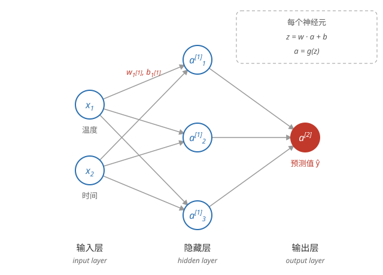

# 神经网络（Neural Network）

## 神经元与大脑

**灵感来源** —— 神经网络的早期目标是用软件模拟大脑。大脑由神经元组成：神经元接收电信号输入，处理后传出信号；神经网络由「神经元」计算单元组成：接收数字输入，算出数字输出。

**只是松散的类比** —— 现代神经网络与大脑只有非常粗糙的相似，不要过度解读。今天的神经网络价值在于工程效果，而不在于模仿生物。

## 神经网络模型

**单个神经元** —— 神经网络的基本单元：计算 $z = \vec{w} \cdot \vec{x} + b$，再经过激活函数 $g(z)$ 输出。带 sigmoid 激活的神经元做的正是[逻辑回归](../ml/logistic-regression.md)：逻辑回归可以看成只有一个神经元的神经网络。

**层（layer）** —— 神经元组织成层，数据从输入层流经隐藏层，到达输出层：

**输入层（input layer）** —— 输入特征 $\vec{x}$，记为 $a^{[0]}$，本身不计算。

**隐藏层（hidden layer）** —— 中间各层，对输入层层加工。训练集不提供这些中间层的真实值，故称「隐藏」。隐藏层有多少层、每层多少个神经元，是设计时选择的。隐藏层很多、网络很深时，就是常说的深度学习（deep learning）。

**输出层（output layer）** —— 最后一层，输出预测结果。

**符号约定** —— $a^{[l]}_j$ 表示第 l 层第 j 个神经元的输出（activation），$\vec{w}^{[l]}_j$、$b^{[l]}_j$ 是该神经元的参数。方括号表示层，与圆括号的样本编号 $x^{(i)}$、下标的特征编号 $x_j$ 区分。

**一个具体例子** —— 咖啡烘焙预测：输入 2 个特征（温度、时间），1 个隐藏层 3 个神经元，输出 1 个值（是否烤得好），结构如图：



第 1 层（隐藏层）每个神经元各算一个逻辑回归：

```math
a^{[1]}_1 = g(\vec{w}^{[1]}_1 \cdot \vec{x} + b^{[1]}_1), \quad a^{[1]}_2 = g(\vec{w}^{[1]}_2 \cdot \vec{x} + b^{[1]}_2), \quad a^{[1]}_3 = g(\vec{w}^{[1]}_3 \cdot \vec{x} + b^{[1]}_3)
```

第 2 层（输出层）以隐藏层的输出为输入：

```math
a^{[2]} = g(\vec{w}^{[2]} \cdot \vec{a}^{[1]} + b^{[2]})
```

## 前向传播

**前向传播（forward propagation）** —— 从输入层开始，从左到右逐层计算，上一层的输出就是下一层的输入，最后得到预测值。向量化写法：

```math
\vec{a}^{[1]} = g(W^{[1]} \vec{x} + \vec{b}^{[1]}), \qquad \vec{a}^{[2]} = g(W^{[2]} \vec{a}^{[1]} + b^{[2]})
```

**为什么叫「前向」** —— 计算方向与数据流向一致；训练时求梯度要反过来从输出层向输入层推导，称为反向传播（backpropagation）。

## 神经网络与逻辑回归

**逻辑回归是特例** —— 没有隐藏层、输出层只有一个 sigmoid 神经元时，神经网络就是逻辑回归。

**隐藏层自动学特征** —— 线性回归和逻辑回归依赖手工特征工程；神经网络的多层结构让隐藏层自己从原始特征中组合出更有用的特征，再交给输出层。网络越深，学到的特征越抽象。

**表达能力** —— 逻辑回归只能画出直线决策边界；带隐藏层的神经网络可以逼近任意函数，决策边界可以是任意复杂的形状。

## 用代码实现

一个隐藏层在 NumPy 中的实现（课程里的 dense 函数）：

```python
def dense(a_in, W, b, g):
    units = W.shape[1]
    a_out = np.zeros(units)
    for j in range(units):
        z = np.dot(W[:, j], a_in) + b[j]
        a_out[j] = g(z)
    return a_out
```

逐层调用就是完整的前向传播：

```python
def sequential(x, W1, b1, W2, b2):
    a1 = dense(x,  W1, b1, g=sigmoid)
    a2 = dense(a1, W2, b2, g=sigmoid)
    return a2
```

**框架封装** —— 实际开发中用 TensorFlow 等框架，声明层结构即可，框架自动完成前向传播和训练：

```python
model = Sequential([
    Dense(units=3, activation='sigmoid'),
    Dense(units=1, activation='sigmoid')
])
model.compile(loss=BinaryCrossentropy())
model.fit(X, y, epochs=100)
```

框架里的 Dense 层就是上面的 dense 函数。

以上是神经网络的结构与前向传播；怎么训练它见[训练模型](./model-training.md)。
