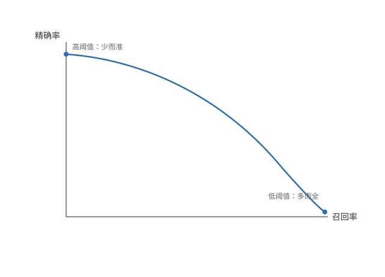

# 精确率与召回率（Precision and Recall）

## 倾斜数据集的错误指标

**准确率会骗人** —— 偏斜数据（skewed data）指一个类别占比极小（如罕见病只占 0.5%）。此时准确率（预测正确的比例）会骗人：模型一律预测「没病」，准确率高达 99.5%，却一个病人都没查出来。

**混淆矩阵（confusion matrix）** —— 按真实类别与预测类别，把预测结果分成四种：

|  | 预测正 | 预测负 |
| --- | --- | --- |
| 真实正 | TP（真正例） | FN（假负例） |
| 真实负 | FP（假正例） | TN（真负例） |

TP、FP、FN、TN 分别是四格的样本数：真正例预测对了，假正例是冤枉的，假负例是漏掉的，真负例是正确排除的。

**精确率（precision）** —— 预测为正的样本里，真正为正的比例：

```math
\text{Precision} = \frac{TP}{TP + FP}
```

查得准不准：精确率高，说明「说是正就是正」，很少冤枉。

**召回率（recall）** —— 真实为正的样本里，被查出来的比例：

```math
\text{Recall} = \frac{TP}{TP + FN}
```

查得全不全：召回率高，说明正例基本都被找到，很少漏掉。

**回到罕见病的例子** —— 一律预测「没病」的模型 TP = 0，召回率为 0：一个病人都没查出来。99.5% 的准确率毫无意义，正是准确率在偏斜数据上骗人的地方。

**F1 分数（F1 score）** —— 单独看任何一个指标都能被钻空子：只预测最有把握的少数几个正例，精确率就很高；干脆全部预测正，召回率就是 100%。需要用一个指标同时要求两者都高。F1 是精确率与召回率的调和平均，公式里的 P 就是精确率（Precision）、R 就是召回率（Recall）：

```math
F_1 = \frac{2PR}{P + R}
```

**调和平均偏向小的** —— 只要 P 或 R 有一个很低，F1 就不会高；F1 高意味着两者都高。例如 P = 0.8、R = 0.9 时 F1 ≈ 0.85；若 R 跌到 0.1，即使 P 还是 0.8，F1 也只剩 ≈ 0.18，一下就被拉低了。比较多个模型时用 F1 挑，而不是单独看精确率或召回率。

## 权衡精确率与召回率

**阈值决定倾向** —— 把阈值调高（如 0.7），只有很有把握才预测正：预测得少而准，精确率高、召回率低；把阈值调低（如 0.3），稍有怀疑就预测正：抓得多但错得多，召回率高、精确率低。

**按需求选平衡点** —— 以召回率为横轴、精确率为纵轴，画出一条精确率-召回率曲线（PR 曲线）：曲线上每个点对应一个阈值，沿曲线走，召回率越高、精确率越低。按业务需求在曲线上取平衡：漏诊代价高（如重病筛查）就优先召回率，误报代价高（如骚扰拦截）就优先精确率。



以上是精确率与召回率；怎么系统性地定位模型的错误（误差分析）在后面的内容里再展开。
