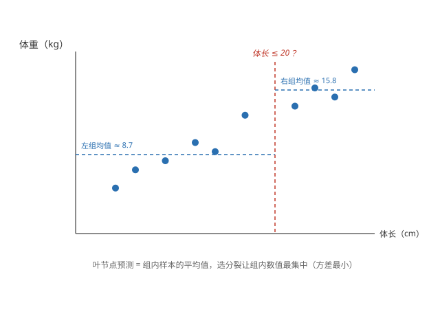
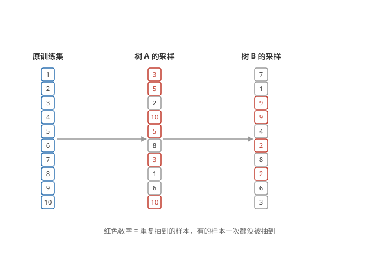
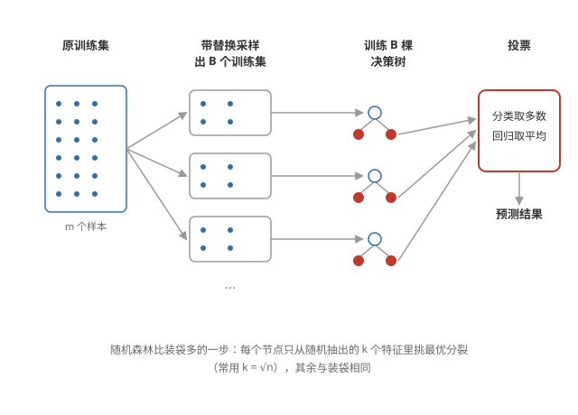
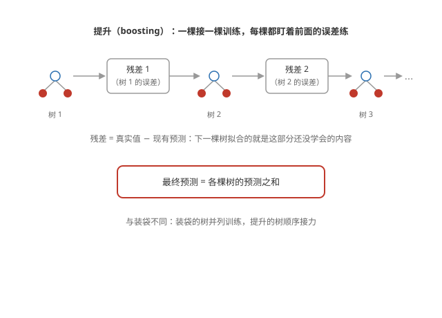

# 回归树（Regression Trees）

## 与分类树的区别

**输出是数值** —— 分类树的叶节点给类别，回归树的叶节点给连续数值（如预测动物的体重）。结构完全一样，只是叶节点内容和选分裂的标准不同。

**选分裂看方差** —— 分类树用信息增益挑分裂，回归树挑那个让左右两组目标值最集中的分裂：左右子集的方差按样本数加权平均，选最小的。

## 怎么选分裂

**方差衡量集中程度** —— 一组数值的方差衡量它们与均值的偏离：方差小，数值集中；方差大，数值分散。分裂的目标就是让左右两组的数值各自更集中。

**加权平均方差** —— 每个候选特征、每个候选阈值，都算一次：

```math
\frac{n^{\text{left}}}{n} \sigma^2_{\text{left}} + \frac{n^{\text{right}}}{n} \sigma^2_{\text{right}}
```

与信息增益同样的思路：左右子集的方差按样本数加权平均，越小越好，取最小的那个分裂。

## 叶节点预测

**取组内均值** —— 落在同一个叶节点的样本，预测值就是它们的平均值。



## 使用多个决策树

**一棵树很脆弱** —— 决策树对训练数据的微小变化非常敏感：换一个样本，整棵树的结构都可能大变，单棵树的预测不稳定。

**多棵树一起投票** —— 训练多棵不同的决策树，让它们投票（分类取多数，回归取平均），整体预测比任何单独一棵都稳。

**树要各不相同** —— 若每棵树都用同一份数据训练，长出来的树都一样，投票没有意义。让树各不相同，靠的是「带替换的采样」：每棵树用不同的随机训练集。

## 带替换的采样

**带替换的采样（sampling with replacement）** —— 从原训练集随机抽 m 次（m 是原集大小），每次抽完把样本放回去再抽。同一个样本可能被抽到多次，也可能一次都没抽到；抽出的新集大小相同、组成不同。

**每棵树一个采样集** —— 对每棵决策树各做一次带替换采样，训练出互不相同的树。



## 随机森林

**装袋决策树（bagged decision tree）** —— 上面「多棵树 + 带替换采样 + 投票」的做法就叫装袋（bagging）。

**随机森林再随机一步** —— 装袋时每棵树的每个节点都从全部 n 个特征里挑最优分裂，树与树之间仍可能相似；随机森林在每个节点只随机抽出 k 个特征（k < n，常用 $k = \sqrt{n}$），只从这 k 个里挑最优分裂，让树与树之间差异更大。

**造树的过程** —— 造 B 棵树（如 B = 100）：每棵树先带替换采样出一个训练集；训练时每个节点只从随机抽出的 k 个特征里挑最优分裂。预测时所有树投票：分类取多数，回归取平均。



**为什么更随机反而更好** —— 随机特征选择让树与树更不相关：各棵树的错误各不相同，投票平均后互相抵消，整体误差更小。随机森林通常比单棵决策树和普通装袋都强。

## XGBoost

**XGBoost 是什么** —— eXtreme Gradient Boosting，提升树（boosted trees）的开源高效实现，竞赛和工业界最常用的树集成算法。

**提升（boosting）与装袋的区别** —— 装袋的树各自独立训练，最后投票；提升的树一棵接一棵训练：下一棵专门补前一棵的短板。

**训练方式：盯着残差练** —— 先训第一棵树；算出它预测的误差（残差 = 真实值 − 预测值）；下一棵树拟合这些残差；再算新误差、再训下一棵……预测时把所有树的预测加起来。



**为什么有效** —— 类似「刻意练习」：每棵树集中练前面没学好的部分，整体误差被一步步压低。

**代码** —— scikit-learn 风格的接口：

```python
from xgboost import XGBClassifier
model = XGBClassifier(n_estimators=100, max_depth=4)
model.fit(X_train, y_train)
```

n_estimators 是树的数量，max_depth 限制每棵树的深度。

**与神经网络怎么选** —— 中小规模表格数据上 XGBoost 常常胜过神经网络；图像、音频、文本等非结构化数据仍是神经网络的主场。

## 什么时候用决策树

**表格数据用树** —— 决策树和树集成在结构化表格数据上表现好，训练也快。

**非结构化数据用神经网络** —— 图像、音频、文本等非结构化数据，神经网络更合适，树很难直接处理原始像素和波形。

以上是回归树与多个决策树的集成方法；课程三的[聚类](../unsupervised/clustering.md)与[强化学习](../rl/reinforcement-learning.md)见后面的笔记。
