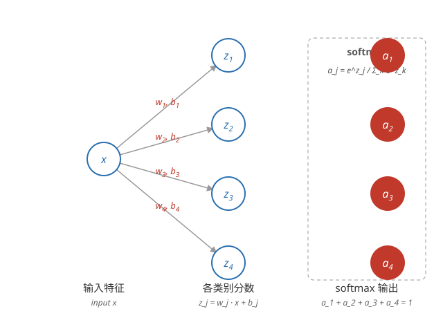

# 多分类 Softmax（Multi-class Classification）

## 什么是多分类

**多分类问题** —— 输出不止两类，而是 N 个可能类别中的一个：识别手写数字 0~9（N=10），或把广告点击后的用户行为归入 4 种之一。此时标签 y 不再是 0/1，而是 1~N 之间的类别编号。

## Softmax 回归

**先给每个类别打分** —— 对每个类别 j 单独算一条线性函数 $z_j = \vec{w}_j \cdot \vec{x} + b_j$，得到 N 个分数。直接取分数最大的类别也可以分类，但拿不到概率；softmax 把这 N 个分数转成概率：

```math
a_j = \frac{e^{z_j}}{\sum_{k=1}^{N} e^{z_k}}
```

每个 $a_j$ 落在 0 到 1 之间，且 $a_1 + a_2 + \dots + a_N = 1$，可解读为 $P(y = j \mid \vec{x})$ 的估计。指数保证输出为正，除以总和完成归一化。

**Softmax 是逻辑回归的推广** —— 类别只有两个时，softmax 与逻辑回归等价：两个输出加起来为 1，同一个 sigmoid 就够了。把「二选一」推广到「N 选一」，就是 softmax。



## 神经网络里的 Softmax 输出层

**输出层用 softmax** —— 多分类网络的输出层有 N 个神经元、激活函数用 softmax，隐藏层照常用 ReLU 或 sigmoid。例如识别手写数字：784 个像素输入 → 隐藏层 25 个 → 隐藏层 15 个 → 输出层 10 个（softmax），输出即 0~9 各自的概率。

## 损失函数与成本函数

**损失函数（loss function）** —— 单个样本的损失，也叫交叉熵损失：真实类别是 j 时

```math
L = -\log(a_j)
```

预测概率 $a_j$ 越接近 1，损失越接近 0；$a_j$ 越接近 0，损失趋向无穷大。即：预测对了损失小，自信地预测错了损失爆炸。

**等价的统一写法** —— 用独热（one-hot）记号：$y_j$ 在真实类别 j 时为 1、其余为 0，损失就是所有类别上的加权和：

```math
L = -\sum_{j=1}^{N} y_j \log(a_j)
```

只有真实类别那一项不是 0，所以等价于 $-\log(a_j)$。二分类时退化为[逻辑回归](../ml/logistic-regression.md)的对数损失（两个输出和为 1，$a_2 = 1 - a$）：

```math
L = -y\log(a) - (1-y)\log(1-a)
```

**成本函数（cost function）** —— 所有样本的损失求和再平均：

```math
J(\vec{w}, \vec{b}) = -\frac{1}{m} \sum_{i=1}^{m} \log a^{(i)}_{y^{(i)}}
```

其中 $a^{(i)}_{y^{(i)}}$ 是模型给第 i 个样本的真实类别打的概率。这是[二元交叉熵](../ml/logistic-regression.md)在 N 类上的推广，梯度下降最小化的就是它。

**稀疏分类交叉熵** —— 标签 y 只是一个类别编号而非独热向量，TensorFlow 里的对应损失叫 SparseCategoricalCrossentropy。

## 用 TensorFlow 训练

```python
model = Sequential([
    Dense(units=25, activation='relu'),
    Dense(units=15, activation='relu'),
    Dense(units=10, activation='softmax')
])
model.compile(loss=SparseCategoricalCrossentropy())
model.fit(X, Y, epochs=100)
```

**优化器** —— fit 默认用 Adam 优化器，见[进阶网络概念](./advanced-concepts.md)。

## 更数值稳定的写法

**中间量丢精度** —— 先算出 softmax 输出、再算交叉熵，中间概率值可能极小，float32 下产生舍入误差，两次运算各丢一次精度。

**线性输出层 + from_logits=True** —— 输出层改用线性激活，把 softmax 合并进损失函数，让 TensorFlow 用更稳定的公式一次算完：

```python
model = Sequential([
    Dense(units=25, activation='relu'),
    Dense(units=15, activation='relu'),
    Dense(units=10, activation='linear')
])
model.compile(loss=SparseCategoricalCrossentropy(from_logits=True))
```

逻辑回归的 sigmoid 同理（TensorFlow 内部就是这么实现 BinaryCrossentropy 的）。注意此时 predict 输出的不再是概率，要概率需自己过一遍 softmax。

## 多分类与多标签

**多标签（multi-label）** —— 一张图里可以同时有公交车、行人、小汽车，多个类别同时为真。这与多分类的「N 选 1」是不同的问题：多标签给每个类别各做一个独立的逻辑回归即可。

**怎么区分** —— 问一句「输出只能有一个类别为真吗」：只能一个，是多分类，输出层用 softmax；可以多个同时为真，是多标签，输出层用多个 sigmoid。

以上是多分类与 softmax 回归；Adam 优化器与卷积层见[进阶网络概念](./advanced-concepts.md)。
