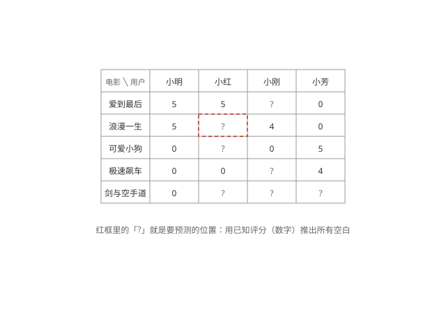
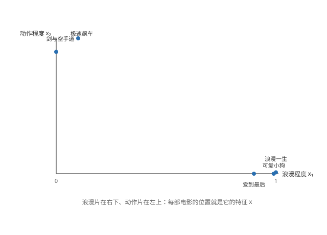
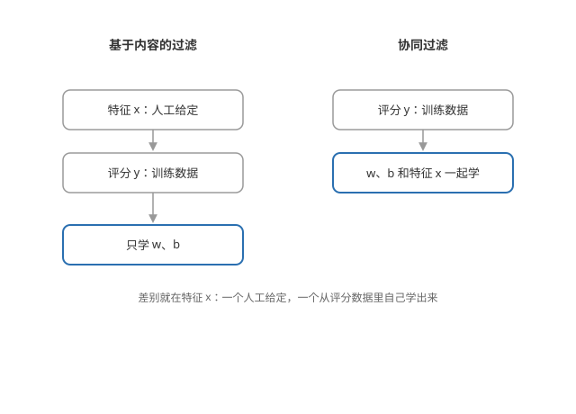
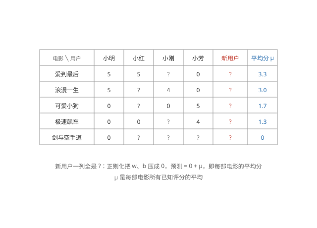

# 推荐系统（Recommender Systems）

## 推荐问题

**问题** —— 预测用户对没看过的内容会打多少分，然后推荐高分的内容。数据是「用户 × 内容」的评分矩阵，大部分位置是空的：每个人只评过一小部分。

**记号** —— n_u 个用户、n_m 部电影；r(i,j) = 1 表示用户 j 评过电影 i，y^(i,j) 是评分。要预测所有空白位置。



## 使用项目特征

**每个项目有特征** —— 假设每部电影都有已知特征 x^(i)：如 x₁ 浪漫程度、x₂ 动作程度。《可爱小狗》x₁ = 0.99、x₂ = 0；《极速飙车》x₁ = 0.1、x₂ = 1.0。



**每个用户学一条线性回归** —— 对每个用户 j 学参数 w^(j)、b^(j)，预测他对电影 i 的评分：

```math
w^{(j)} \cdot x^{(i)} + b^{(j)}
```

**每个用户一个成本函数** —— 只在该用户评过的电影上算误差，加正则化：

```math
J(w^{(j)}, b^{(j)}) = \frac{1}{2} \sum_{i:\, r(i,j)=1} \left( w^{(j)} \cdot x^{(i)} + b^{(j)} - y^{(i,j)} \right)^2 + \frac{\lambda}{2} \sum_k \left( w_k^{(j)} \right)^2
```

**本质就是线性回归** —— 与预测房价的线性回归完全一样，只是每个用户各做一次。学到 w^(j)、b^(j) 后，把没评过的电影特征代进去，就得到预测评分。这叫基于内容的过滤（content-based filtering）：靠项目本身的特征做推荐，用户之间互不影响。

## 协同过滤

**特征不知道怎么办** —— 现实中「浪漫程度、动作程度」不是现成的。协同过滤（collaborative filtering）让算法同时学两样东西：每个用户的参数 w、b，和每部电影的特征 x。

**成本函数** —— 把「学用户参数」和「学电影特征」两个目标合并，对全部已知评分求和（加正则化项）：

```math
J(w, b, x) = \frac{1}{2} \sum_{(i,j):\, r(i,j)=1} \left( w^{(j)} \cdot x^{(i)} + b^{(j)} - y^{(i,j)} \right)^2
```

梯度下降同时更新 w、b 和 x。

**互相成就** —— 从评分里既推出用户的口味，又推出电影的特征——这就是「协同」：用户的数据帮电影，电影的数据帮用户。

## 协同过滤与基于内容的对比

**特征从哪来** —— 基于内容的过滤：电影特征事先人工给定（浪漫程度、动作程度），算法只学用户参数 w、b。协同过滤：特征不用给定，和用户参数一起从评分数据里学出来。

**各需要什么** —— 基于内容的过滤要求每部电影都有现成的特征值；协同过滤不挑特征，但要有足够多的评分数据才学得动。

**冷启动** —— 新电影没有评分时，协同过滤学不到它的特征、没法推荐；基于内容的过滤只要标好了特征，就能推荐新电影。

**可以结合** —— 实际系统常把两者混用：既有现成特征，又让评分数据补上特征，合起来推荐。



## 二元标签与均值归一化

**二元标签** —— 推荐也可以是「点没点、喜不喜欢」（0/1），把线性回归换成逻辑回归即可。

**新用户的问题** —— 新用户没评过任何电影，他的成本函数一项都没有，正则化会把 w^(j)、b^(j) 压成 0，预测全是 0 分——但 0 不是有意义的评分。

**均值归一化** —— 把每部电影的评分减去这部电影的平均分 μ_i（按电影归一化）：

```math
y^{(i,j)}_{\text{norm}} = y^{(i,j)} - \mu_i
```

用归一化后的评分训练；预测时把均值加回来：

```math
\hat{y}^{(i,j)} = w^{(j)} \cdot x^{(i)} + b^{(j)} + \mu_i
```



**为什么有用** —— 新用户的 w、b 仍是 0，预测 = 0 + μ_i：他得到的是每部电影的「大众平均分」，比一律 0 分合理得多；对评过电影的老用户，模型学的则是「比平均高还是低」。

## 找相关的内容

**特征就是相似度** —— 学出的电影特征 x^(i) 刻画了电影本身：两部电影的特征距离 $\| x^{(i)} - x^{(k)} \|^2$ 越小，它们越相似——「看了这部电影的人也可能喜欢」的推荐就是这么来的。

以上是推荐系统；课程三的内容到这里基本齐全。
