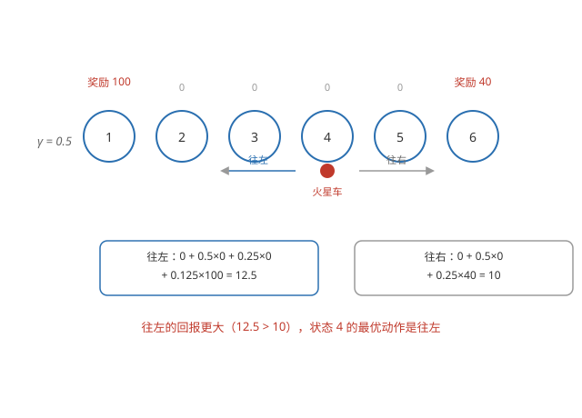

# 强化学习（Reinforcement Learning）

## 什么是强化学习

**与监督学习不同** —— 没有带标签的数据集，只有奖励信号（reward）：智能体（agent）在环境里做动作，环境给出奖励，目标是把长期累积的奖励最大化。

**应用** —— 控制机器人、优化工厂流程、金融交易、玩游戏。

**关键概念** —— 状态（state）、动作（action）、奖励（reward）。典型例子：火星车在 6 个位置之间移动，每个状态有不同的奖励。

## 回报（return）

**回报 = 奖励之和** —— 从开始到结束，把每个时刻拿到的奖励加起来。目标就是让回报最大：有时需要先牺牲眼前的奖励（绕远路），换取更大的长期回报。

**折扣因子 γ** —— 远处的奖励打折扣，更在意眼前：

```math
\text{Return} = R_1 + \gamma R_2 + \gamma^2 R_3 + \dots
```

γ 接近 1 时眼光长远，γ 接近 0 时只看眼前。

## Q 函数

**状态动作价值函数 Q(s, a)** —— 在状态 s 做一次动作 a，之后每一步都走最优，能拿到的最大回报。比较 Q(s, a) 就知道在状态 s 该做哪个动作。

**最优策略** —— 在每个状态选 Q 最大的动作：π(s) = argmaxₐ Q(s, a)。



## 贝尔曼方程

**怎么算 Q** —— Q(s, a) 可以拆成「这一步的奖励 + 下一步开始的最优回报」：

```math
Q(s, a) = R(s) + \gamma \max_{a'} Q(s', a')
```

s' 是做动作 a 之后到达的状态。这个方程叫贝尔曼方程（Bellman equation）。

## 连续状态空间与 DQN

**状态太多怎么办** —— 火星车只有 6 个状态，可以建表逐个算；现实中状态往往是连续的（位置、速度、角度……），不可能枚举。

**用神经网络算 Q** —— 输入状态 s，输出每个动作的 Q 值，这就是 DQN（Deep Q-Network）。训练数据靠自己试：让智能体跑，把每一步 (s, a) 配上贝尔曼方程右端算出的目标值，反复训练神经网络。

**探索与利用** —— 训练时不能只走当前最优的动作，要偶尔随机试新动作（ε-greedy：以概率 ε 随机探索），才能发现更好的路径。

以上是强化学习的基础；[聚类](../unsupervised/clustering.md)等课程三的其他内容见后面的笔记。
