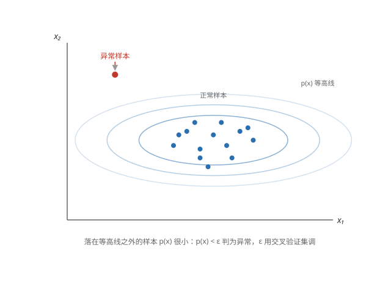
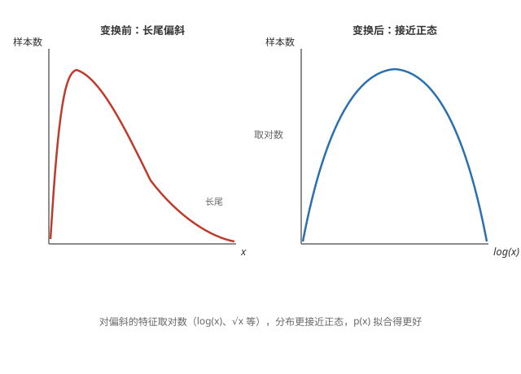

# 异常检测（Anomaly Detection）

## 什么是异常检测

**找出异常样本** —— 用已有的正常数据学出「正常」的样子，新样本偏离太多就是异常。应用：金融欺诈检测（异常的刷卡记录）、工厂质检、服务器监控。

**与监督学习的区别** —— 异常样本极少甚至没有标签，只能拿正常样本学习，因此用无监督的方法。

## 高斯分布

**每个特征拟合一个正态分布** —— 假设每个特征 x_j 服从高斯（正态）分布，用数据估计均值 μ 和方差 σ²：

```math
\mu_j = \frac{1}{m} \sum_{i=1}^{m} x_j^{(i)}, \qquad \sigma_j^2 = \frac{1}{m} \sum_{i=1}^{m} (x_j^{(i)} - \mu_j)^2
```

**密度函数 p(x)** —— 各特征的密度乘起来，就是样本整体的「正常程度」：

```math
p(x) = \prod_{j=1}^{n} \frac{1}{\sqrt{2\pi}\sigma_j} \exp\left(-\frac{(x_j - \mu_j)^2}{2\sigma_j^2}\right)
```

**拆开看：两层乘积** ——

**外层连乘 ∏** —— 把 n 个特征各自的密度乘起来：p(x) = p(x₁)·p(x₂)···p(x_n)。只要有一个特征的值很不寻常，那一项就很小，整个 p(x) 就被拉低——任何一维离谱，整体就判为异常。

**内层是两项相乘** —— 每个特征的密度本身又由两部分组成：

```math
p(x_j) = \underbrace{\frac{1}{\sqrt{2\pi}\sigma_j}}_{\text{归一化系数}} \cdot \underbrace{\exp\left(-\frac{(x_j - \mu_j)^2}{2\sigma_j^2}\right)}_{\text{偏离均值的惩罚}}
```

归一化系数保证密度曲线下的面积恰好是 1（σ_j 越大数据越分散，系数越小、曲线越矮胖）；指数部分才是关键：x_j 离均值 μ_j 越远，指数越负、这项越小——距离用方差 σ_j² 度量，除以 σ_j² 等于拿 σ 当尺子量距离。

**exp 是什么** —— exp(y) 就是 e 的 y 次方（e ≈ 2.718），即 $e^y$。这里的 exp(−(x_j−μ_j)²/2σ_j²) 就是 $e^{-(x_j-\mu_j)^2/2\sigma_j^2}$。指数部分恒 ≤ 0：x_j 恰好等于 μ_j 时指数为 0，exp(0) = 1，密度取到最大；偏离越远指数越负，e 的负大数次方迅速趋近 0。e^x 衰减快、平滑且永不为负，这正是正态分布「钟形曲线」的来源。

p(x) 大说明样本长得像见过的正常数据，p(x) 小说明它很陌生。

## 判断异常

**阈值 ε** —— p(x) < ε 就判为异常。ε 用交叉验证集来调：让验证集上的精确率/召回率合适（如 F1 最大）。



**局限** —— 假设各特征独立且服从正态分布；特征相关或分布形状复杂时效果会打折。

## 选择使用哪些特征

**让特征更像正态** —— p(x) 假设每个特征服从正态分布，但实际特征常常是长尾偏斜的。做一步变换能让它更像正态：log(x)、log(x+c)、√x 等。变换后正态假设更成立，p(x) 拟合得更好。



**做误差分析来挑特征** —— 先跑一遍模型，看被漏掉的异常样本：它们的 p(x) 不小，说明现有特征分不出它，就去找一个能把它和正常样本区分开的新特征。

**组合出新特征** —— 单个特征看不出异常时，把两个特征组合起来常常有用。例如数据中心监控：单独看「CPU 负载」和「网络流量」都正常，但它们的比值一旦异常就暴露问题。异常样本往往在某个特征（或组合特征）上取到特别大或特别小的值。

以上是异常检测；课程三的[推荐系统](../recommenders/recommender-systems.md)见后面的笔记。
