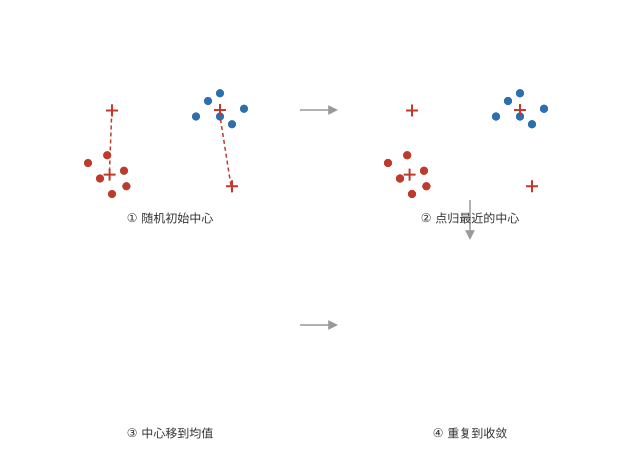
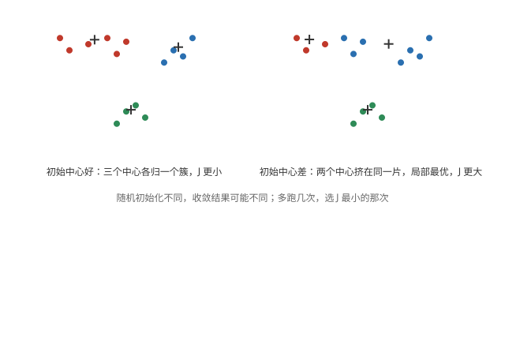
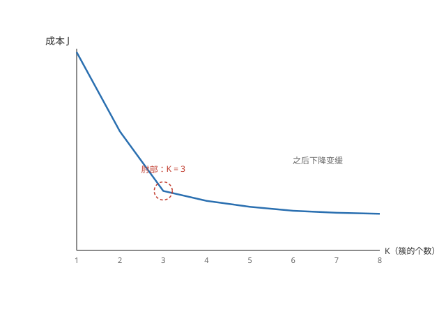

# 聚类（Clustering）

## 什么是聚类

**无监督学习** —— 数据没有标签，让算法自己把相似的样本归成一组（簇，cluster）。应用：新闻自动归类、市场细分（用户分组）、DNA 分析、天文数据分析。

## K-means 算法

**两步循环** —— 先把数据分成 K 个簇（K 预先指定）：

**第一步：分配点** —— 每个点归给离它最近的簇中心（centroid）。

**第二步：移动中心** —— 每个簇的中心移到簇内所有点的平均位置。

**重复直到收敛** —— 两步交替，直到簇中心和分配不再变化。



## 优化目标

**成本函数** —— 每个点到它所属簇中心的距离平方，所有点求和平均：

```math
J = \frac{1}{m} \sum_{i=1}^{m} \| x^{(i)} - \mu_{c^{(i)}} \|^2
```

μ_c(i) 是点 i 所属簇的中心。K-means 的每一步都在压低这个 J，所以算法必然收敛。

**两个步骤各降一半** —— 分配点是在簇中心固定时把 J 压到最小；移动中心是在分配固定时把 J 压到最小。

## 初始化与局部最优

**随机初始化** —— 随机选 K 个样本点作为初始中心。不同的初始中心可能收敛到不同的结果，有些是局部最优。

**多跑几次** —— 用不同随机初始化跑几十次，选 J 最小的那次结果。K 较小时（如 2~10）多次运行很有效。



## 怎么选 K

**肘部法（elbow method）** —— 画出 J 随 K 的变化：J 一直下降，若在某处出现「肘部」（之后下降明显变缓），就取那个 K。可惜肘部不一定明显。



**按下游任务选** —— 更实际的做法：看聚类结果用在什么地方，按业务需要决定 K（如做 T 恤尺码，S/M/L 就取 K = 3）。

以上是聚类与 K-means；[异常检测](./anomaly-detection.md)等无监督学习的其他内容见后面的笔记。
