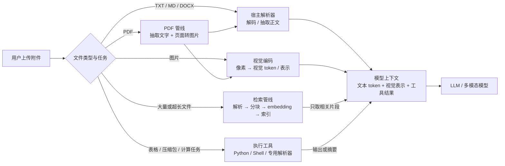

# LLM 如何“读取附件”：从文本注入到多模态与 RAG

> 研究口径：这里的“出现”不是争夺某项能力的绝对首发，而是选取有一手资料可核验、对通用大模型影响较大的公开节点。更新时间：2026-10-13。

## 结论先行

“LLM 会读附件”不是一个单独出现的模型能力，而是四条技术路线在产品层汇合后的用户体验：

1. **文本文件经宿主解析后注入上下文**：模型一直都能处理被转换成 token 的文本；“上传文件”主要是应用层能力。2023 年的 100K/128K 长上下文让整本书、数百页文档直接放入 prompt 变得实用。
2. **图片原生多模态理解**：代表性研究节点是 2022 年 Flamingo；通用前沿模型与聊天产品在 2023 年通过 GPT-4、GPT-4V、Gemini 进入主流。
3. **PDF/文档作为一等输入**：2023 年末开始成为通用多模态模型的明确能力。但今天多数所谓“原生 PDF”仍由平台先提取文字、把页面渲染成图片，再把两种表示交给模型，并不是模型直接理解 PDF 二进制字节。
4. **工具式文件检索 / RAG**：研究基础在 2020 年已经形成；2023—2024 年随着 Assistants、Retrieval、File Search 与工具调用被托管化，成为用户上传大批文件后按需问答的标准产品能力。

因此，若一定要回答“这是大模型发展的哪个阶段才出现的”，最稳妥的说法是：

> **用户今天感知到的附件能力，集中出现于 2023 年的“长上下文 + 多模态 + 工具调用/Agent 产品化”阶段；它建立在 2020 年的检索增强研究和 2022 年的视觉语言模型研究之上。**

## 一、模型实际看到了什么



“上传成功”只说明平台拿到了文件，不说明模型读取了原始文件。模型通常只会看到以下一种或几种表示：

| 路径 | 模型实际输入 | 是否可称为模型原生能力 | 典型限制 |
| --- | --- | --- | --- |
| 文本注入 | 宿主抽取出的文本 token | 否，文件解析属于宿主；语言理解属于模型 | 上下文长度、解析质量、编码与格式丢失 |
| 图片输入 | 由视觉编码器产生的视觉 token / 表示 | 是，多模态模型能力 | 分辨率、视觉 token 成本、OCR 与空间推理误差 |
| PDF/文档输入 | 常见实现是抽取文字 + 页面图像 | 部分；文档接入是平台能力，页面理解依赖视觉模型 | 页数、图表与版式、扫描质量、双份 token 成本 |
| File Search / RAG | 检索器挑出的少量文本块 | 否，检索与索引属于外部系统 | 分块、召回、重排可能漏掉关键信息 |
| Code Interpreter 等工具 | 程序执行结果、采样数据或摘要 | 否，模型负责决定如何调用并解释结果 | 工具可用性、沙箱限制、输出截断 |

这个边界可以从当前厂商文档直接验证：OpenAI 的 File Inputs 文档说明，非 PDF 文档通常只抽取文字；PDF 会同时提取文字和页面图像。Anthropic 的 PDF 文档则更明确地写出：系统把每页转成图片，并把抽取文字与图片一起交给 Claude。也就是说，“PDF 输入”是一条文档处理管线，不是把 `%PDF-...` 字节串直接喂给语言模型。

- [OpenAI：File inputs](https://developers.openai.com/api/docs/guides/file-inputs)
- [Anthropic：PDF support](https://platform.claude.com/docs/en/build-with-claude/pdf-support)
- [Google：Gemini Document understanding](https://ai.google.dev/gemini-api/docs/document-processing)

## 二、四条能力路线

### 1. 文本附件：本质是“宿主解析 + 上下文注入”

纯文本模型并不认识“文件”这个应用概念。宿主需要先读取文件、识别编码或格式、抽取正文，再把正文放进消息或 prompt；模型看到的只是普通 token。换句话说，只要一段文件内容能够复制粘贴进上下文，早期文本 LLM 就已经能对它做摘要和问答，上传按钮并没有创造新的语言能力。

真正的瓶颈是上下文窗口。Anthropic 在 2023 年 5 月把 Claude 的上下文从 9K 扩到 100K，并明确演示整本《了不起的盖茨比》以及“数百页材料”的分析；OpenAI 在 2023 年 11 月发布的 GPT-4 Turbo 提供 128K 上下文，官方称约可容纳 300 多页文本。这让“整份长文直接注入”从小文件技巧变成可用方案。

- [Anthropic：Introducing 100K context windows，2023-05-11](https://www.anthropic.com/news/100k-context-windows)
- [OpenAI：GPT-4 Turbo with 128K context，2023-11-06](https://openai.com/index/new-models-and-developer-products-announced-at-devday/)

当前 OpenAI 文档仍能看出这层分工：Responses API 对 DOCX、PPTX、TXT 和代码文件抽取文字；Chat Completions 若要处理普通文本文件，则要求应用自行读取后作为 text content 发送。这是宿主能力，不要求模型拥有视觉能力。

### 2. 图片：需要真正的视觉语言模型

图片不能像 TXT 一样直接 token 化成自然语言。模型需要视觉编码器或统一的多模态表示，把像素变成可与文本共同注意的表示。

2022 年 4 月，DeepMind 发布 Flamingo，输入接口可以接受交错的图片、视频与文字，并输出语言；其实现把已预训练的视觉表示与语言模型通过新增架构连接起来。这是“大语言模型式少样本能力”进入开放式视觉问答的代表性节点，而不是视觉语言研究的绝对起点。

2023 年 3 月的 GPT-4 技术报告把 GPT-4 定义为可接受交错文字与图片、输出文字的多模态模型；同年 9 月，OpenAI 才开始把图片能力正式推向 ChatGPT Plus 和 Enterprise 用户。这区分了**模型公开**和**产品可用**两个时间点。

- [Google DeepMind：Flamingo，2022-04-28](https://deepmind.google/blog/tackling-multiple-tasks-with-a-single-visual-language-model/)
- [OpenAI：GPT-4 Technical Report，2023-03-14](https://cdn.openai.com/papers/gpt-4.pdf)
- [OpenAI：ChatGPT can now see, hear, and speak，2023-09-25](https://openai.com/index/chatgpt-can-now-see-hear-and-speak/)

2024 年 5 月的 GPT-4o 又把文本、音频、图片、视频统一到 “omni” 模型叙事中，标志多模态从附加能力进入通用模型主线；但这不是附件上传的起点。

- [OpenAI：Hello GPT-4o，2024-05-13](https://openai.com/index/hello-gpt-4o/)

### 3. PDF/文档：容器接入与页面理解是两层能力

PDF 同时包含文字、字体、绘图指令、位图、表格和页面布局，不能把“读到正文”和“理解整页视觉结构”混为一谈：

- **文本模式**：抽取 PDF 的文本层，模型能回答正文问题，但可能看不到扫描页、图片、图表和空间布局；
- **视觉模式**：把每页渲染成图片，同时提供抽取文字，让多模态模型理解图表、布局与扫描内容；
- **检索模式**：解析并分块，只把命中的片段放进上下文，适合大型资料库，但不保证整份文档都被模型看过。

2023 年 12 月，Gemini 1.0 是“通用大模型原生文档输入”的一个清晰公开节点。其技术报告称，Gemini 从一开始就是多模态模型，训练输入包括自然图片、图表、截图、PDF 与视频；Google 的发布文章也强调它不是把独立模态组件临时拼接起来，而是从预训练阶段就支持多模态。

- [Google DeepMind：Gemini 1.0 Technical Report，2023-12](https://deepmind.google/gemini/gemini_1_report.pdf)
- [Google：Introducing Gemini，2023-12-06](https://blog.google/innovation-and-ai/technology/ai/google-gemini-ai/)

不过，“原生 PDF”仍需谨慎理解。即使今天的官方 API 接受 `application/pdf`，OpenAI 和 Anthropic 的文档也都描述了文字抽取与页面图像化步骤；Gemini 当前文档也说明 PDF 页面按图片处理，并对原生文本做抽取。因此，更准确的术语是**一等 PDF API + 原生视觉理解**，而不是“模型直接解释文件容器字节”。

### 4. File Search / RAG：不是通读，而是“先找再读”

当文件总量超过上下文窗口时，系统通常不会把全部内容发给模型，而是：

```text
文件 → 解析 → 分块 → embedding / 索引
用户问题 → 检索 / 重排 → 选中少量片段 → 注入模型上下文
```

这条路线早于聊天产品的附件按钮。Google 的 REALM 和 Meta 团队的 RAG 论文都发表于 2020 年：前者在预训练、微调和推理阶段显式检索外部文档；后者把生成模型的参数记忆与 Wikipedia 的稠密向量索引结合。它们奠定了“模型不必把所有知识放在参数或当前 prompt 中”的技术路线。

- [Google Research：REALM，ICML 2020](https://research.google/pubs/retrieval-augmented-language-model-pre-training/)
- [Lewis 等：Retrieval-Augmented Generation，2020-05-22](https://arxiv.org/abs/2005.11401)

产品化发生在 2023—2024 年。OpenAI 在 2023 年 11 月推出 Assistants API，把 Retrieval 与 Code Interpreter 作为托管工具：Retrieval 用用户文档补充模型知识，Code Interpreter 在沙箱中运行代码并处理多种文件。2024 年 4 月，`file_search` 与 vector store 进一步把解析、分块、embedding、索引和检索封装成平台能力。

- [OpenAI：Assistants API、Retrieval 与 Code Interpreter，2023-11-06](https://openai.com/index/new-models-and-developer-products-announced-at-devday/)
- [OpenAI API Changelog：File Search，2024-04-17](https://developers.openai.com/api/docs/changelog)
- [OpenAI：Retrieval / Vector stores](https://developers.openai.com/api/docs/guides/retrieval)

工具调用本身也在 2023 年进入主流 API：OpenAI 2023 年 6 月的 Function Calling 让模型可靠地产生外部函数参数；但真正读取文件的是宿主工具，模型只负责选择工具、组织参数并消费工具返回值。

- [OpenAI：Function calling，2023-06-13](https://openai.com/index/function-calling-and-other-api-updates/)

## 三、关键时间线

| 时间 | 代表节点 | 它真正带来的能力 |
| --- | --- | --- |
| 2020 | REALM、RAG | 外部文档检索与生成模型结合；这是检索增强，不是附件 UI |
| 2022-04 | Flamingo | LLM 风格的交错图片/视频/文本 prompt 与少样本多模态学习 |
| 2023-03 | GPT-4 技术报告 | 通用前沿模型明确接受文字与图片输入；当时视觉输入仍未全面产品化 |
| 2023-05 | Claude 100K | 数百页文本可直接放进一次上下文，长文档注入变得实用 |
| 2023-06 | OpenAI Function Calling | 模型可选择外部函数，为文件工具与 Agent 编排补齐控制接口 |
| 2023-07 | ChatGPT Code Interpreter beta | 普通用户可上传文件，由沙箱代码分析、制图和编辑；这是最早一批主流“附件体验” |
| 2023-09 | ChatGPT 图片能力 rollout | 原生视觉理解进入主流聊天产品 |
| 2023-11 | GPT-4 Turbo、Assistants Retrieval / Code Interpreter | 长上下文、托管检索与文件工具在开发平台汇合 |
| 2023-12 | Gemini 1.0 | 从预训练起原生多模态，技术报告明确把 PDF 列为视觉输入之一 |
| 2024-04 | OpenAI File Search | 托管 vector store、自动解析/分块/embedding/检索进入成熟产品形态 |
| 2024-05 | GPT-4o | 文本、视觉、音频等统一多模态成为旗舰模型主线 |

ChatGPT Code Interpreter 的历史日期来自 OpenAI 官方 Release Notes：2023 年 7 月 6 日开始向 Plus 用户推出，可访问用户上传文件；8 月 3 日又加入多文件分析。

- [OpenAI：ChatGPT release notes](https://help.openai.com/en/articles/6825453-chatgpt-release-notes)

## 四、如何判断一个系统到底是哪种“读附件”

看到附件功能时，可以依次问四个问题：

1. **文件由谁打开？** 是业务后端解析，还是模型通过工具读取？
2. **模型收到什么？** 全文、页面图片、检索片段，还是程序执行结果？
3. **是否要求视觉模型？** TXT/MD 正文不要求；图片、扫描 PDF、图表与版式通常要求。
4. **是否真的通读全文？** RAG 只读取召回片段；长上下文直注入才可能让全文进入一次请求，但进入上下文也不等于每个细节都能可靠召回。

据此可以避免几个常见误判：

- 有上传按钮，不等于模型能直接访问文件系统；
- 能总结 PDF 正文，不等于看到了其中的图表；
- API 接受 PDF，不等于模型直接理解 PDF 二进制格式；
- File Search 回答了文件问题，不等于模型通读了所有文件；
- 上下文足够长，也不等于检索或长上下文召回一定准确。

## 五、最终判断

若讨论**纯文本附件**，它主要是宿主工程能力，理论上从文本 LLM 能接受足够上下文时就存在；2023 年长上下文让它显著实用化。

若讨论**图片附件**，代表性的 LLM 多模态研究在 2022 年成形，2023 年进入 GPT-4/Gemini 等通用前沿模型和聊天产品。

若讨论**保留图表与版式的 PDF 理解**，较稳妥的时间点是 2023 年末至 2024 年的原生多模态与文档管线融合阶段。

若讨论**大量文件的知识问答**，其研究基础在 2020 年，主流托管产品形态则在 2023—2024 年形成。

所以，“附件能力”更像一次系统工程收敛：**LLM 提供语言/视觉理解，长上下文提供容量，RAG 提供选择性读取，工具调用提供行动接口，宿主应用负责文件解析、权限、存储与编排。**
